# Northstar Ops — GeoIntelligence & Service Operations Hub

> Parameterized Geo-Intelligence platform, Multi-Model AI Strategy Council, native Jira UI Kit dashboard, and Atlassian Forge Rovo + MCP ecosystem for local field-service operators.

[](https://nsops.vercel.app)
[](https://developer.atlassian.com/platform/forge/)
[](https://nsops.vercel.app/api/mcp)
[](https://nextjs.org)

- **Live Web Application:** https://nsops.vercel.app
- **Web MCP Discovery & `llms.txt`:** https://nsops.vercel.app/api/mcp · https://nsops.vercel.app/llms.txt
- **Privacy Policy & Terms:** https://nsops.vercel.app/privacy · https://nsops.vercel.app/terms
- **Forge App ID:** `ari:cloud:ecosystem::app/0f3e249d-8d6d-42b2-a2a8-dc3aa49696d0` (`Runs on Atlassian` eligible — zero external egress)

---

## 1. The Real-World Problem & Live Business Validation

Local field-service businesses (upholstery and carpet cleaning, HVAC, plumbing, event & detailing services) rarely lose customers because of poor craft—they lose margin and leads because of **fragmented pricing intelligence and manual Jira/Confluence coordination**:

- Competitors hide prices inside React/Vite SPA bundles, `/cennik` subpages, or unstructured Google Business listings.
- Operators underprice core services or absorb out-of-zone fuel and travel costs without transparent distance rules.
- Insights discovered in ad-hoc spreadsheets never turn into structured Confluence playbooks or actionable Jira marketing epics.

**Northstar Ops** solves this end-to-end. Rather than relying on synthetic mockups, it is validated against a **live regional operator case study** for [**SUPER PUCUŚ**](https://pranie-dywanow.j.pl/) (upholstery & carpet extraction in **Radom, Poland**, `10–100 km` service radius with real OpenStreetMap towns including Pionki, Jedlińsk, Przytyk, and Wierzbica), while remaining **100% parameterized** for any city worldwide, any custom service niche, `PLN / USD / EUR / GBP` currencies, and any public website URL.

---

## 2. Architecture Overview

Northstar Ops combines two synchronized layers: a **parameterized Next.js Intelligence Hub** and a **native Atlassian Forge UI Kit + Rovo + MCP App (`northstar-ops-rovo/`)** eligible for **Runs on Atlassian**.

```mermaid
flowchart LR
  subgraph WEB["Web Geo-Intelligence Hub (Next.js 16 · nsops.vercel.app)"]
    direction TB
    W1["Geo Radar & OSM Resolver<br/>/api/geo/resolve · 10–100 km Global Coverage"]
    W2["SPA Price & Competitor Sync<br/>SSRF Guard · Live HTML/JS + Serper / OSM"]
    W3["Multi-Model AI Strategy Council<br/>Gemini 4 Hydrogen → Groq 429 Fallback + HITL"]
    W4["Open Web MCP Gateway<br/>/api/mcp JSON-RPC 2.0 · /llms.txt"]
  end

  subgraph FORGE["Atlassian Forge App (Runs on Atlassian · Zero Egress)"]
    direction TB
    F1["Native Jira Project UI Kit<br/>jira:projectPage · @forge/react · EN/PL & Free Plan"]
    F2["Rovo Agent & Skill<br/>Northstar Ops Geo Strategist · SKILL.md"]
    F3["Forge MCP & 4 Actions<br/>Brief · Zone Quote · Playbook · Jira Epic"]
  end

  subgraph OUT["Atlassian Cloud Outputs (api.asUser)"]
    direction TB
    O1["Jira Epics & Quotes<br/>Campaign Tasks & Quote Tickets"]
    O2["Confluence Playbooks<br/>Audit-Ready Strategy Docs"]
  end

  WEB -->|"Jira REST v3"| FORGE
  WEB -->|"Confluence REST v2"| FORGE
  FORGE --> O1
  FORGE --> O2

  style WEB fill:#eff6ff,stroke:#93c5fd,stroke-width:2px,color:#091e42
  style FORGE fill:#eff6ff,stroke:#0052cc,stroke-width:2px,color:#091e42
  style OUT fill:#ecfdf5,stroke:#00875a,stroke-width:2px,color:#091e42
```



| Layer               | Component                       | Endpoint / Module                       | Security & Fallbacks                                                                               |
| :------------------ | :------------------------------ | :-------------------------------------- | :------------------------------------------------------------------------------------------------- |
| **Web Geo Hub**     | Geo Radar & OSM Resolver        | `/api/geo/resolve`                      | OpenStreetMap Nominatim + Overpass + Wikidata race                                                 |
| **Web Geo Hub**     | SPA Price & Competitor Sync     | `/api/pricing/sync`, `/api/market/scan` | SSRF guard; Serper.dev with DuckDuckGo/OSM + deterministic parser fallback                         |
| **Web Geo Hub**     | Multi-Model AI Strategy Council | `/api/council`                          | `Gemini 4 Hydrogen` → Groq (`429` failover) + cross-provider Critic + HITL rules                   |
| **Web Geo Hub**     | Open Web MCP Gateway            | `/api/mcp`, `/llms.txt`                 | JSON-RPC 2.0 discovery & 6 parameterized tools (`distanceKm` global quoting)                       |
| **Atlassian Forge** | Native Jira Project UI Kit      | `jira:projectPage` (`@forge/react`)     | `Runs on Atlassian` zero-egress (`nodejs24.x`, `api.asUser()`), works on Jira Free                 |
| **Atlassian Forge** | Rovo Agent & Skill              | `rovo:agent` + `rovo:skill`             | `Northstar Ops Geo Strategist` + `SKILL.md` operational playbook                                   |
| **Atlassian Forge** | Forge MCP & 4 Actions           | `rovo:mcp` + 4 Forge functions          | `get-market-brief`, `calculate-service-fee`, `publish-confluence-playbook`, `create-jira-campaign` |

---

## 3. Core Capabilities

### A. Global Geo-Intelligence & Interactive Coverage Map

- **Any City Worldwide:** Resolves coordinates and surrounding towns within `10–100 km` using OpenStreetMap Nominatim, Overpass API, and Wikidata SPARQL races (`/api/geo/resolve`).
- **Interactive SVG Coverage Radar:** Smooth zoom (`+ / − / Reset` up to `5.5x`), dynamic `10–100 km` radius slider synced with KPI cards, keyboard-accessible town pins, and straight-line distance + drive-time estimations with `cos(lat)` projection correction.
- **Bilingual & Multi-Currency (`PL` / `EN`):** Strict i18n dictionaries (`src/locales/pl|en/*.json`) with `Intl.NumberFormat` currency formatting and full Light/Dark mode.

### B. Universal SPA Price Sync & Live Competitor Discovery

- **Live Website Pricing Sync (`/api/pricing/sync`):** Extracts service menus from static HTML, JSON-LD, client-side React/Vite JS bundles, and `/cennik` subpages, normalized into structured service units (`m²`, `pcs`). Includes SSRF protection and deterministic fallback parsing.
- **Competitor & Pain-Point Scanner (`/api/market/scan`):** Discovers real local competitors via Google Maps & Google Search (`Serper.dev`, with DuckDuckGo/OSM fallback), filters out lead-gen aggregators, compares market averages per service, and extracts verified customer review pain points.

### C. Cross-Provider Multi-Model AI Strategy Council (`HITL`)

Pricing decisions never rely on a single unchallenged LLM prompt:

1. **Round 1 — Strategist:** Proposes concrete pricing moves grounded in live competitor averages and customer pain points.
2. **Round 2 — Independent Critic (Cross-Provider, Fresh Context):** Runs in an isolated session on a different model/provider family (Gemini ↔ Groq `openai/gpt-oss-120b` / `qwen/qwen3.8-27b` or OpenAI) to challenge margin/churn risks, calculate a `riskScore`, and enforce operator limits.
3. **Round 3 — Moderator Synthesis:** Produces two distinct go-to-market options (**Option A** vs **Option B**) for human selection.
4. **Human-in-the-Loop & Lessons Learned:** Operators can enforce custom rules (e.g., _"Do not raise corner sofa above 250 PLN"_) and persist approved rules in browser `localStorage` so every subsequent council debate inherits past governance decisions.
5. **Direct Atlassian Execution:** Clicking **Publish Strategy to Confluence** or **Create Jira Campaign** sends the approved `councilContext` (selected option, AI audit trail, critic warnings, and action items) straight to Confluence and Jira.

### D. Native Atlassian Forge App (`northstar-ops-rovo/`)

- **Runtime:** `nodejs24.x`, `arm64`, `256 MB`, zero external egress (**Runs on Atlassian** compliant).
- **Modules in `northstar-ops-rovo/manifest.yml`:**
  - `jira:projectPage`: `northstar-ops-jira-page` (_Northstar Ops_, `render: native` UI Kit via `@forge/react`, `@forge/resolver`, and `@forge/bridge`) — embeds live Jira issues (`/rest/api/3/search/jql`), live Confluence pages, `EN / PL` UI switch, custom or preset industries, `10–100 km` radius, `PLN / USD / EUR / GBP` currency switching, a zone quote calculator that creates Jira quote tickets, and one-click Confluence playbook publishing & Jira campaign creation directly inside any Jira project (including Jira Cloud Free plans without a Rovo Chat button).
  - `rovo:agent`: `northstar-ops-geo-strategist` (_Northstar Ops Geo Strategist_)
  - `rovo:skill`: `geo-pricing-strategist` (`skills/geo-pricing-strategist/SKILL.md`)
  - `rovo:mcp`: `northstar-ops-mcp` (_Northstar Ops MCP Server_)
  - `action` + `function`:
    - `get-market-brief` (`GET`) — Regional benchmarks (`PLN/USD/EUR/GBP`), preset or custom industry support, radius coverage (`10–100 km`), customer pain points, and live Jira + Confluence workspace context
    - `calculate-service-fee` (`GET`) — Global zone travel fee, drive-time estimate, and total customer quote calculator for any town and `distanceKm`
    - `publish-confluence-playbook` (`CREATE`) — Creates a formatted strategy playbook page in Confluence
    - `create-jira-campaign` (`CREATE`) — Creates a parent Jira Epic + linked execution tasks
- **Scopes:** `read:space:confluence`, `read:page:confluence`, `write:page:confluence`, `read:jira-work`, `write:jira-work`

### E. Open Web MCP Endpoint (`/api/mcp` & `/llms.txt`)

In addition to the Forge MCP server (`rovo:mcp`), the web hub exposes a full **MCP JSON-RPC 2.0** endpoint at `POST /api/mcp` (discoverable via `GET /api/mcp` and `/llms.txt`) with 6 global tools:

1. `analyzeCompetitors`
2. `calculateServiceFee` _(supports any global city/town and optional `distanceKm`)_
3. `generateLocalizedCampaign`
4. `exportStrategyToConfluence`
5. `createJiraMarketingEpics`
6. `createCustomerQuote` _(creates a live Jira lead/quote task directly from the Customer Price Preview calculator)_

Example JSON-RPC call:

```bash
curl -X POST https://nsops.vercel.app/api/mcp \
  -H "Content-Type: application/json" \
  -d '{
    "jsonrpc": "2.0",
    "id": 1,
    "method": "tools/call",
    "params": {
      "name": "calculateServiceFee",
      "arguments": { "town": "Pionki", "orderValue": 250, "distanceKm": 22 }
    }
  }'
```

---

## 4. Tech Stack

- **Web Framework:** Next.js `16.4.6` (App Router, Turbopack), React `19`, TypeScript `5.7.3` (strict)
- **Styling & UI:** Tailwind CSS v4 (`@tailwindcss/postcss`), shadcn/ui (`button`), `lucide-react`, `Plus Jakarta Sans` & `JetBrains Mono`
- **AI & Search:** `@google/genai` (`gemini-4-hydrogen`), Groq OpenAI-compatible fallback chain (`openai/gpt-oss-120b` → `qwen/qwen3.8-27b` → `openai/gpt-oss-20b`), optional OpenAI fallback, Serper.dev Google Search & Maps, OpenStreetMap + Wikidata
- **Atlassian Platform:** Atlassian Forge CLI, `@forge/api ^8.5.0`, `@forge/react ^12.5.0`, `@forge/resolver ^2.0.2`, `@forge/bridge`, Confluence REST API v2, Jira REST API v3, UI Kit `jira:projectPage`, Rovo Agent, Rovo Skill, Rovo MCP Server
- **Testing & Verification:** Node.js built-in test runner (`node --test tests/*.test.mjs`) + strict TypeScript (`tsc --noEmit`)
- **Package Manager:** `pnpm` (root web app) · `npm` (`northstar-ops-rovo/` Forge bundle)

---

## 5. Repository Structure

```text
.
├── app/
│   ├── api/
│   │   ├── council/route.ts         # 3-round cross-provider AI Strategy Council
│   │   ├── geo/resolve/route.ts     # Global city + radius town resolver (OSM + Wikidata)
│   │   ├── market/scan/route.ts     # Live competitor & customer pain-point scanner
│   │   ├── mcp/route.ts             # Web MCP JSON-RPC 2.0 endpoint
│   │   └── pricing/sync/route.ts    # SSRF-safe HTML/JSON-LD/SPA price extractor
│   ├── opengraph-image.tsx          # Dynamic 1200x630 OpenGraph & Twitter card
│   ├── privacy/page.tsx             # GDPR/RODO privacy notice
│   ├── terms/page.tsx               # Terms of service
│   ├── robots.ts & sitemap.ts       # Search & AI crawler metadata
│   └── layout.tsx & page.tsx        # Root App Router entry & JSON-LD schema
├── northstar-ops-rovo/              # Native Atlassian Forge UI Kit + Rovo + MCP app
│   ├── manifest.yml                 # jira:projectPage, rovo:agent, rovo:skill, rovo:mcp, actions & scopes
│   ├── skills/geo-pricing-strategist/SKILL.md
│   └── src/
│       ├── index.js                 # Forge Rovo handlers & UI Kit resolver (Jira v3 & Confluence v2)
│       └── frontend/index.jsx       # Native Atlassian UI Kit Jira projectPage (EN/PL, tokens)
├── public/
│   ├── llms.txt                     # Machine-readable AI discovery specification
│   └── site.webmanifest             # PWA manifest & custom Northstar Ops icons
├── tests/
│   └── project-invariants.test.mjs  # Automated architectural, i18n, MCP & Forge parity tests
└── src/
    ├── backend/                     # Gemini client, AI Council engine, MCP tools, REST bridge
    ├── config/                      # Parameterized industry templates & market geo math
    ├── frontend/components/         # Dashboard, GIS SVG map, competitor table, calculator, Rovo & Council UI
    ├── lib/                         # Haversine distance, projection math, currency formatting
    └── locales/                     # Strict EN & PL i18n JSON dictionaries
```

---

## 6. Local Development & Deployment

### Prerequisites

- Node.js `22+` or `24+`
- `pnpm` (`npx pnpm` works out of the box via Corepack)
- Atlassian Forge CLI (`npx @forge/cli`) for deploying `northstar-ops-rovo/`

### 1. Run & Verify the Next.js Web Hub

```bash
npx pnpm install
cp .env.example .env.local
```

Fill in `.env.local` (never commit secrets):

| Variable                         | Required        | Purpose                                                              |
| -------------------------------- | --------------- | -------------------------------------------------------------------- |
| `GEMINI_API_KEY`                 | Recommended     | Primary AI extractor, market structurer & Council Strategist         |
| `GROQ_API_KEY`                   | Recommended     | Cross-provider Devil's Advocate Critic & automatic 429 fallback      |
| `GROQ_TEXT_MODEL`                | Optional        | Custom Groq model override (defaults to `openai/gpt-oss-120b` chain) |
| `OPENAI_API_KEY`                 | Optional        | Alternative cross-provider Critic if Groq is unset                   |
| `SERPER_API_KEY`                 | Recommended     | Google Search & Google Maps competitor discovery                     |
| `ENABLE_GEMINI_SEARCH_GROUNDING` | Optional        | Set `"true"` to prioritize Gemini Search Grounding before Serper     |
| `NEXT_PUBLIC_SITE_URL`           | Optional        | Canonical URL for `robots.txt` & `sitemap.xml`                       |
| `ATLASSIAN_BASE_URL`             | For live export | Your Atlassian Cloud site (e.g. `https://your-site.atlassian.net`)   |
| `ATLASSIAN_EMAIL`                | For live export | Atlassian account email for REST API auth                            |
| `ATLASSIAN_API_TOKEN`            | For live export | Atlassian API token                                                  |
| `ATLASSIAN_CONFLUENCE_SPACE_KEY` | Optional        | Target Confluence space key (default: `northstarg`)                  |
| `ATLASSIAN_JIRA_PROJECT_KEY`     | Optional        | Target Jira project key (default: `KAN`)                             |

Verify types, invariants, and production build:

```bash
npx pnpm typecheck
npx pnpm test
npx pnpm build && npx pnpm start
```

### 2. Validate & Deploy the Atlassian Forge App

```bash
cd northstar-ops-rovo
npm ci
npx @forge/cli lint
npx @forge/cli deploy -e production --non-interactive
npx @forge/cli install --non-interactive --site <your-site>.atlassian.net --product jira --environment production
npx @forge/cli install --non-interactive --site <your-site>.atlassian.net --product confluence --environment production
```

---

## 7. Automated Invariant Checks (`pnpm test`)

`tests/project-invariants.test.mjs` guards project quality continuously with 5 structural checks:

1. **100% EN/PL i18n Parity:** Ensures identical keys and non-empty strings across all `src/locales/en/*.json` and `src/locales/pl/*.json` namespaces.
2. **Zero Inline Styles:** Verifies zero `style={{...}}` attributes across Next.js TSX components and Forge UI Kit JSX sources.
3. **Strict TypeScript Build:** Confirms `next.config.mjs` never enables `ignoreBuildErrors: true`.
4. **Web MCP & `llms.txt` Parity:** Verifies all 6 MCP tools match `public/llms.txt` and support global `distanceKm` quoting without hardcoded town lists.
5. **Forge `Runs on Atlassian` & Manifest Parity:** Confirms zero `external:` egress permissions, zero `fetch()` calls inside Forge handlers/UI Kit, and full parity between `manifest.yml`, `SKILL.md`, `index.js`, and `src/frontend/index.jsx`.

---

## 8. Security, Privacy & Compliance

- **Zero Client Secret Exposure:** All AI keys, Serper tokens, and Atlassian API credentials remain strictly server-side.
- **SSRF Guarding:** `/api/pricing/sync` validates schemes and blocks loopback/private network ranges before fetching external websites.
- **Runs on Atlassian:** The `northstar-ops-rovo` Forge app performs zero external network egress and executes Confluence/Jira mutations via `api.asUser()`.
- **GDPR / Consent Mode v2:** Built-in bilingual cookie consent manager (`analytics_storage`, `ad_storage`) with persistent preferences and `/privacy` + `/terms` routes.

---

## License

Built for **Atlassian Codegeist 2026**. See repository metadata and legal notices in `/privacy` and `/terms`.
